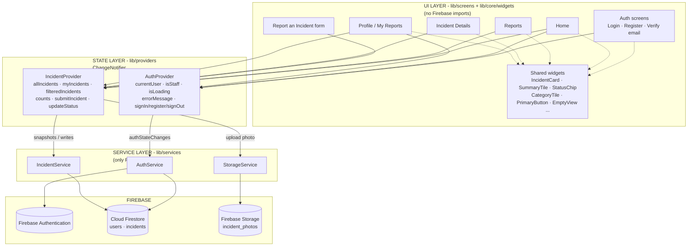
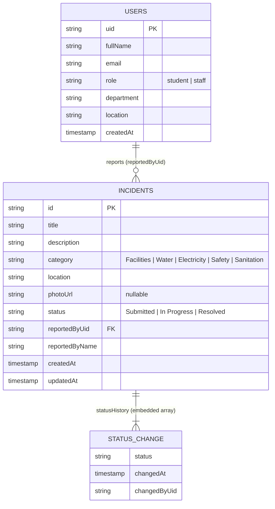

# Campus Incident Reporting — Technical Report

**Student:** ELie Kuradusenge
**Course:** Mobile Application Development — Formative Assignment 2
**Application:** `campus_incident_app` (Flutter, Android / iOS / Web)
**Date:** November 2026

| Resource | Link |
|---|---|
| GitHub repository | https://github.com/elkuradusenge/incident-report-app |
| Demo video | [https://github.com/elkuradusenge/incident-report-app/blob/develop/video/](video/demo.mp4) |

---

## 1. Introduction and Problem Statement

Universities receive maintenance and safety complaints through informal channels: a message to a class representative, a note in a WhatsApp group, or a verbal mention to a lecturer. These channels lose information. A leaking tap reported on Monday is forgotten by Wednesday; a broken projector is reported to three different people and fixed once; nobody can tell a reporter whether their issue was ever resolved. Facilities staff, for their part, have no single queue of work and no record of when a problem was resolved.

The Campus Incident Reporting application addresses this by giving every member of the university one place to **report**, **track** and **resolve** campus incidents. A student picks a category (Facilities, Water, Electricity, Safety, Sanitation), writes a title and description, chooses a campus location, optionally attaches a photo, and submits. The report is persisted in Cloud Firestore and appears immediately in the reporter's list and in the shared reports feed. Staff members see the same report and move it through a three-step lifecycle — *Submitted → In Progress → Resolved* — with each transition timestamped into an audit trail.

The functional requirements the implementation satisfies are: ALU-restricted email registration with email verification; authenticated, role-aware access; real-time incident lists; photo attachment (optional); a three-state workflow owned by staff; live summary counters; and a responsive interface that runs on Android, iOS and the web from a single codebase.

---

## 2. Application Architecture

The application is deliberately layered. Each layer has one responsibility and only depends on the layer beneath it:

1. **UI layer (`lib/screens/`, `lib/core/widgets/`)** — stateless or locally-stateful widgets. Screens read data through `Provider` and never import a Firebase package. Reusable widgets (`IncidentCard`, `SummaryTile`, `StatusChip`, `CategoryTile`, `PrimaryButton`, `AppTextField`, `EmptyView`, `ErrorView`, `LoadingView`, `ResponsiveShell`) keep the screens declarative.
2. **State layer (`lib/providers/`)** — two `ChangeNotifier`s: `AuthProvider` (session, verification state, role, error messages) and `IncidentProvider` (live lists, filters, counters and write actions). Providers convert service results into UI-ready state and hold no Firebase references of their own.
3. **Service layer (`lib/services/`)** — the *only* code that touches Firebase: `AuthService` (Firebase Authentication + the `users` collection), `IncidentService` (the `incidents` collection) and `StorageService` (Firebase Storage). Services accept injected SDK instances, which is what makes the providers testable with fakes.
4. **Firebase** — Authentication, Cloud Firestore and Cloud Storage, plus the security rules that enforce access control on the server.

The data flow is therefore strictly one-directional: **UI → Provider → Service → Firebase**, and back up through streams (`snapshots()`) that cause the provider to notify listeners, which rebuilds only the widgets that depend on the changed data.

### Architecture diagram



---

## 3. Firebase Data Structure

Two top-level collections are used. They are intentionally shallow: every screen is served by at most two listeners, and status transitions are embedded rather than stored in a sub-collection so that a report and its history always arrive in a single read.

### `users/{uid}`

Keyed by the Firebase Authentication UID, so a profile is fetched with one document read.

| Field | Type | Notes |
|---|---|---|
| `uid` | string | Same as the document id |
| `fullName` | string | Captured at registration |
| `email` | string | ALU address |
| `role` | string | `"student"` (assigned at sign-up) or `"staff"` (set by an administrator in the Console) |
| `department` | string | Optional; blank at registration, editable later |
| `location` | string | Optional; residence/campus location |
| `createdAt` | timestamp | Server timestamp |

### `incidents/{incidentId}`

| Field | Type | Notes |
|---|---|---|
| `id` | string | Pre-generated document id (also stored as a field) |
| `title` | string | 5+ characters (validated in the form) |
| `description` | string | 15+ characters |
| `category` | string | `Facilities`, `Water`, `Electricity`, `Safety`, `Sanitation` |
| `location` | string | From the fixed campus location list |
| `photoUrl` | string \| null | Download URL from Firebase Storage; `null` when no photo |
| `status` | string | `Submitted`, `In Progress`, `Resolved` |
| `reportedByUid` | string | Reporter's UID (used for ownership and "my reports") |
| `reportedByName` | string | Denormalised so lists render without a second read |
| `createdAt` | timestamp | Server timestamp |
| `updatedAt` | timestamp | Server timestamp, refreshed on each status change |
| `statusHistory` | array\<map\> | Ordered audit trail: `{ status, changedAt, changedByUid }` |

Categories and statuses are modelled as Dart enums (`IncidentCategory`, `IncidentStatus`) whose `label` is the exact string written to Firestore, so an invalid value is unrepresentable in the app and any unexpected stored value falls back safely on read.

### Data-model diagram



### File storage

Photos are written to `incident_photos/{uid}/{incidentId}.jpg`. The path is user-scoped so the Storage rules can enforce ownership by the second path segment. The upload happens **before** the Firestore document is created, which is why the incident id is pre-generated (`IncidentService.newIncidentId()`); if the upload fails, no half-written document is left behind.

---

## 4. State Management Approach and Justification

The assignment mandates **Provider** with `ChangeNotifier`. Two providers were used, split by concern:

**`AuthProvider`** owns the session. It subscribes to `AuthService.authStateChanges`, exposes `currentUser`, `isSignedIn`, `isEmailVerified`, `isStaff`, `isLoading`, `isSubmitting`, `errorMessage`, and the actions `signIn`, `register`, `resendVerificationEmail`, `refreshEmailVerification`, `reloadProfile`, `signOut`. It also maps every `FirebaseAuthException` to a human-readable sentence, so screens never show raw SDK errors.

**`IncidentProvider`** owns the data. It holds `allIncidents` and `myIncidents` (both fed by live Firestore streams), the search text, the status and category filters, and the computed `filteredIncidents`. It exposes live counters (`myReportCount`, `mySubmittedCount`, `myInProgressCount`, `myResolvedCount`) and the write actions `submitIncident`, `updateStatus` and `deleteIncident`, each guarding its own preconditions (`isStaff`, `canDelete`) and its own loading/error state.

**Why Provider was appropriate here**

- *Fit to the data flow.* Firestore is already a stream of immutable snapshots. A `ChangeNotifier` is the thinnest possible adapter between that stream and the widget tree; nothing has to be copied into a second store, and there is no boilerplate beyond `notifyListeners()`.
- *Shared state without prop-drilling.* The home counters, the reports list, the details page and the profile stats all read the same `IncidentProvider`. A single Firestore change updates all of them — no manual refresh, no duplicated queries.
- *Separation of concerns.* Screens contain no business rules. Whether a user may update a status is decided once, in the provider (and again, authoritatively, in the security rules), not in each widget.
- *Testability.* Because both providers accept injected services, the entire UI could be exercised in widget tests with fake services, with no emulator, no network and no Firebase project.
- *Proportionality.* Riverpod or BLoC would also work, but they add concepts (families, providers-as-values, events/states) that this scope does not need. Provider is officially recommended for beginners by the Flutter team and is small enough to read end-to-end.

`setState` is used **only** for state that no other widget can observe: the selected bottom-bar tab, the report form's controllers and picked photo, the details screen's pending dropdown value, and the password-visibility toggle. The Profile tab's status filter is deliberately local too, because reusing the provider's single `statusFilter` would have silently re-filtered the Reports tab.

---

## 5. User Roles and Access Control

### Roles

| Capability | Student | Staff |
|---|---|---|
| Register with an ALU email | Yes | No (accounts created by an administrator) |
| Browse all incidents | Yes | Yes |
| Create an incident (`status = Submitted`) | Yes | Yes |
| Delete an incident | Own report, only while `Submitted` | No |
| Change status | No | Yes |

### ALU email restriction

Only two institutional domains are accepted, declared once in `core/constants/auth_constants.dart`:

```dart
static const List<String> allowedEmailDomains = <String>[
  'alustudent.com',
  'alueducation.com',
];
```

`AuthConstants.isAluEmail()` normalises the address (trim + lowercase) and compares the domain **after** the last `@`, which rejects look-alikes such as `someone@alustudent.com.evil.com`. The registration form runs `validateAluEmail`, which shows the inline error *"Only ALU emails are allowed (@alustudent.com or @alueducation.com)"*. This is a client-side convenience; the authoritative protection is that the account itself cannot be created for an unapproved domain, and all writes additionally require `email_verified == true`.

### Email verification

Registration creates the Auth user, writes `users/{uid}` with `role: "student"`, and sends a verification email. `AuthGate` then routes purely on state:

| Session state | Screen |
|---|---|
| Signed out | Login |
| Signed in, `emailVerified == false` | Verify email (`I have verified` / `Resend email`) — the app itself is unreachable |
| Signed in and verified | Main shell (Home / Reports / Profile) |

`I have verified` calls `user.reload()` and re-reads the flag, so verification completes without signing out. Sessions persist across restarts because Firebase Authentication caches the credential and `authStateChanges` re-emits on start-up; a `LoadingView` covers that restore window.

### Server-side enforcement (Firestore rules)

Client-side hiding is a UX measure, not a security boundary. The rules duplicated below are the boundary:

- **All writes require a verified email**; all reads require a signed-in user.
- **Creating an incident** is allowed only when `reportedByUid` equals the caller's UID, `status` is exactly `"Submitted"`, and the document's `id` matches its path — so nobody can file a report on another student's behalf or inject an already-resolved report.
- **Updating an incident** requires the caller's `users/{uid}.role == "staff"`, allows only the keys `status`, `updatedAt` and `statusHistory` to change, and restricts `status` to the three allowed values. A student's update is rejected by the server even if the UI were tampered with.
- **Deleting an incident** requires ownership *and* the current stored status to still be `"Submitted"`, which is exactly the rule the three-dot menu applies in the UI.
- **Users documents**: a user may read only their own document, may create it only with `role == "student"`, and may never change their own `role` (staff promotion happens only in the Firebase Console).

### Storage rules

Uploads are restricted to `incident_photos/{uid}/…` when the caller's UID matches that folder, the content type matches `image/.*`, and the object is smaller than 5 MB. Reading photos is allowed to any signed-in user (they are shown on incident cards). A catch-all `allow read, write: if false` denies every other path.

---

## 6. UI/UX Decisions

**One design system.** All colours, radii, spacing and type live in `core/theme` and `core/constants/app_sizes.dart`, so a value is changed once. The palette: primary purple `#6C3CF0`, hero gradient `#7B4DFF → #A58BFF`, page white `#FFFFFF`, neutral screen edge `#F4F2FA`, text `#1B1B2F` / `#6B6B80` / `#A0A0B2`, borders `#E6E4F0`; tinted summary tiles (lavender `#EFEAFF`, blue `#E6F0FF`, green `#E2F6EA`, red `#FDE6EA`) and status chips (amber `#FFE7B3`/`#B86E00`, lilac `#EDE7FF`/`#5B2EE0`, green `#DDF5E6`/`#1E8E4E`). Radii follow the specification exactly — 16 for cards, 22 for the hero, 14 for buttons, 12 for inputs and thumbnails, 10 for chips — as do the 20 px screen padding, 52 px button height, 76×64 category tiles, 70 px bottom bar with a raised 56 px purple "+". Plus Jakarta Sans is applied globally through `google_fonts`, with a 26/18/15/13/12 type scale.

**Navigation.** A single shell with an `IndexedStack` keeps the three tabs alive, so scroll position and filters survive tab switches; the raised "+" in the bar and the hero button both open the definitive reporting flow. Details are pushed as a route, so the system back gesture behaves as users expect.

**Feedback states everywhere.** Every list distinguishes *loading* (`LoadingView`), *empty* (`EmptyView`, with different copy for "you have no reports" versus "nothing matches your filters") and *error* (`ErrorView` with a retry that re-subscribes). Every form validates inline — category, title (≥5), description (≥15), location, email, password, confirm-password, name. Every asynchronous action disables its button, shows a spinner and reports the outcome: a success SnackBar ("Report submitted successfully.", "Status updated to Resolved.", "Report deleted.") or a red error SnackBar carrying the mapped Firebase message, while the form keeps the user's input intact so nothing is retyped.

**Responsive layout.** `ResponsiveShell` centres the app in a 430-pixel column and paints `#F4F2FA` around it, so the phone UI looks intentional on a wide desktop browser instead of stretching. Inside, content is built with `SafeArea`, single-child scroll views, `Expanded`/`Flexible` and ellipsis on every single-line text, which was verified at 360, 390 and 1200 pixels wide (see §7).

**Accessibility-minded details.** Minimum tap targets are respected on tappable rows, colour is never the only signal (status chips and timeline circles also carry text/icons), and destructive actions are guarded by a confirmation dialog.

--- 0794305872 jean 

## 7. Testing Strategy

Testing combined three layers: static analysis (`flutter analyze`, zero issues), automated widget tests with faked services, and manual/visual verification. Because the UI only talks to providers, providers receive injected fake services in tests; no emulator, network or Firebase project is required.

Automated coverage (files under `test/`): model serialisation round-trips and unknown-value fallbacks; ALU-email and validator rules; auth error mapping; provider behaviour (live lists, filters, counters, submit, staff-only status change, delete rules); screen behaviour for Home, Reports, Report form, Incident Details and Profile; and a layout suite that renders the shell tabs, both auth screens, the report form and the details page at **360 × 640, 390 × 844 and 1200 × 900**, asserting no overflow and a 430-pixel content column on wide screens.

### Manual test table

Legend: **Pass** = verified by automated widget test and/or rendered in Chrome; **Pending live** = logic verified with fakes but needs a run against the configured Firebase project (`flutterfire configure`) to confirm end-to-end.

| # | Scenario | Steps | Expected result | Actual result | Status |
|---|---|---|---|---|---|
| 1 | Authentication & ALU restriction | Register with `student@gmail.com`; then with `student@alustudent.com` and valid password; open the verification link; tap *I have verified*; sign out; sign in again | Non-ALU address rejected inline; ALU sign-up creates the Auth user and a `users/{uid}` document with `role: "student"`; verification email sent; unverified sessions land on the Verify screen; verified sessions reach Home; session survives restart | Inline error *"Only ALU emails are allowed (@alustudent.com or @alueducation.com)"* appeared at 390 px; validators and routing rules verified by widget tests; `AuthGate` shows Verify for unverified and the shell when verified | Pass (logic) / **Pending live** for email delivery |
| 2 | Submit incident | Tap "+", pick *Water*, enter a 5+ character title and 15+ character description, choose a location, tap *Submit Report* | Inline errors while invalid; button spins while saving; document created with `status: "Submitted"`, reporter UID/name and a one-entry `statusHistory`; form pops back with a success SnackBar | Empty submit produced four inline errors; valid submit created the report with the expected fields (asserted in tests); pop + "Report submitted successfully." shown | Pass |
| 3 | Photo upload (optional) | Tap the dashed photo box, pick an image from the gallery, remove it with ✕, pick again and submit | Preview replaces the dashed box; ✕ clears it; photo uploaded to `incident_photos/{uid}/{incidentId}.jpg` before the write; `photoUrl` stored; submission also succeeds with **no** photo | Preview/remove verified; bytes-based upload path compiles and runs on web; upload skipped when no photo (asserted) | Pass (logic) / **Pending live** for real Storage round-trip |
| 4 | Browse, search, filter | Open *Reports*; type "projector"; tap *In Progress*; tap *Water*; return to *All* | List narrows as the user types across title, description and location; chips filter by status and category; combined filters can yield the empty state; no reload needed | Search matched title, description and location; chips filtered; combined filters produced "No reports found"; filters are independent of the Profile tab | Pass |
| 5 | Status update by staff | Sign in as a staff account, open an incident, choose *Resolved* in *Update Status*, tap *Update*; watch a student's open details page | Status, `updatedAt` and a new `statusHistory` entry written; student's screen updates live without refresh; success SnackBar shown | Update section visible only for staff; `updateStatus` invoked with the chosen value; timeline/counters driven by the stream (asserted); live cross-device update follows from `streamIncident` | Pass (logic) / **Pending live** for two-device check |
| 6 | Role restriction | As a student: look for *Update Status* and the three-dot menu; also attempt a direct update with the REST API/tampered client | No staff UI for students; menu only on own reports while `Submitted`; server rejects any non-staff status write with `permission-denied` | Staff section absent for students; menu hidden once the status moves past `Submitted`; provider also refuses non-staff updates | Pass (client) / **Pending live** for rule rejection proof |

---

## 8. Challenges Encountered

1. **Web-safe image handling.** The natural approach (`dart:io File`) compiles on Android but breaks the web build. The solution was to keep everything in bytes: `XFile.readAsBytes()` for the picker, `Image.memory` for the preview and `putData` for the upload — one code path for all three platforms.
2. **`google_fonts` type mismatch.** In the installed major version the generated `plusJakartaSansTextTheme()` helper returns a `TextTheme` from a different package than Flutter's, so it could not be assigned to `ThemeData.textTheme`. The fix was to derive the family from `GoogleFonts.plusJakartaSans()` and apply it to Flutter's own `TextTheme`.
3. **Server timestamps inside arrays.** `FieldValue.serverTimestamp()` cannot be nested inside an array element, so document-level `createdAt`/`updatedAt` use server timestamps while each `statusHistory` entry stores a client `Timestamp`. Documented as a deliberate trade-off.
4. **Avoiding composite indexes.** Ordering a user-filtered query requires a composite index that would have to be deployed. The user stream filters on `reportedByUid` only and sorts in Dart, so no index is needed for the demo.
5. **Role changes at runtime.** A user promoted to `staff` in the Console does not see the change until the profile is re-read; `AuthProvider.reloadProfile()` exists for exactly that, and the security rules always use the freshly stored role.
6. **Layout robustness under extreme text metrics.** The layout suite initially flagged overflow on the auth screens at 360 px because the test font renders every glyph as a square (far wider than Plus Jakarta Sans). The footer rows were converted from `Row` to `Wrap`, which is also the correct behaviour for large accessibility text sizes.
7. **Provider configuration order.** `firebase_options.dart` had to exist for the project to compile before the Firebase project was linked; a clearly-marked placeholder is shipped and is overwritten by `flutterfire configure`.

---

## 9. Limitations

1. **Staff accounts are created manually.** There is no staff sign-up UI by design; an administrator edits `role` to `staff` in the Firebase Console.
2. **No push notifications.** Status changes are visible while the app is open (real-time streams) but not delivered when it is closed.
3. **No pagination.** Both listeners load the full incident collection, which is fine at campus scale but would need `limit()` + pagination for thousands of records.
4. **Deleting a report does not delete its photo.** The Storage rules permit the owner to remove it, but the provider only deletes the Firestore document.
5. **No client-side image compression.** Uploads are guarded by a 5 MB limit rather than resized, so large photos are rejected instead of shrunk.
6. **Search is client-side.** Title/description/location search runs over the loaded list; Firestore full-text search would require an external index.
7. **Fixed location list.** Campus locations come from a constant list, not an editable collection.
8. **Role changes need a reload.** Promotion is reflected after `reloadProfile()` or a new sign-in.
9. **Email verification is out-of-band.** The link opens in the browser; no deep link returns the user to the app automatically.
10. **Web font fetching.** Plus Jakarta Sans is fetched at runtime on first load; a slow or blocked network falls back to the platform font.

---

## 10. Lessons Learned

- **A layered architecture pays for itself the moment requirements change.** Because only three service classes know about Firebase, adding the Incident Details screen, the Reports filters and the Profile tab required no changes to authentication, storage or security rules.
- **The server is the only real authority.** Hiding the update control for students is politeness; the `isStaff()` rule is what actually protects the data. Writing both made the distinction concrete.
- **Streams remove a whole class of bugs.** "Refresh after write" logic disappears when every screen derives from `snapshots()`; the details page updates itself because it listens to one document.
- **Design tokens prevent drift.** Centralising colours, radii and type meant the "exact design values" requirement survived eleven incremental feature prompts without a visual audit.
- **Fakes are cheaper than emulators.** Injecting service interfaces made every screen testable in seconds and made regression checking after refactors (shared empty states, shared thumbnails, shared chips) trivial.
- **Test fonts lie.** Automated overflow checks are valuable, but they measure a worst-case font; a failure must be diagnosed before the layout is "fixed".
- **Plan for the platform you demo on.** Choosing bytes over `File` on day one avoided a late rewrite when the only preview target was Chrome.

---

## 11. Screenshots to Capture

The following twelve screenshots must be included (390 × 844 for mobile screens; full-window for the web and Console shots):

1. **Login** — app title, subtitle, ALU email and password fields, purple *Sign in* button.
2. **Register** — four fields showing inline validation errors (ideally an invalid non-ALU email).
3. **Verify email** — the *I have verified* / *Resend email* screen with the verification address.
4. **Home** — greeting, avatar, hero card with illustration, four summary tiles, three recent reports, bottom bar with raised "+".
5. **Report an Incident form** — a category selected, filled fields, location chosen, and either the dashed photo box or a photo preview.
6. **Reports list with filters** — search text typed, a status chip and a category chip selected, filtered cards visible.
7. **Incident Details** — summary card, three-step timeline with times, description.
8. **Staff status update** — an incident opened as a staff account showing the *Update Status* dropdown and *Update* button (ideally with the confirmation SnackBar).
9. **Profile / My Reports** — avatar, name, role chip, department/location, three stat tiles, filter chips and own reports.
10. **Firebase Console → Authentication → Users** — showing verified/unverified users.
11. **Firebase Console → Firestore → `incidents`** — a document with `status`, `reportedByUid` and the `statusHistory` array expanded (plus the `users` document with `role`).
12. **Firebase Console → Storage → `incident_photos`** — the per-user folder containing an uploaded `.jpg`.

Also capture the wide-screen version (1200 px browser window) of screenshot 4 to evidence the centred 430-pixel column with the `#F4F2FA` surround.

---

## 12. References

American Psychological Association. (2020). *Publication manual of the American Psychological Association* (7th ed.). https://doi.org/10.1037/0000165-000

Flutter. (2025). *Flutter documentation*. https://docs.flutter.dev/

Flutter. (2025). *Simple app state management*. https://docs.flutter.dev/data-and-backend/state-mgmt/simple

Google. (2025). *Cloud Firestore security rules*. Firebase documentation. https://firebase.google.com/docs/firestore/security/get-started

Google. (2025). *Cloud Storage security rules*. Firebase documentation. https://firebase.google.com/docs/storage/security

Google. (2025). *Firebase Authentication documentation*. https://firebase.google.com/docs/auth

Google. (2025). *Plus Jakarta Sans* [Typeface]. Google Fonts. https://fonts.google.com/specimen/Plus+Jakarta+Sans

Google. (2025). *provider* (Version 6.1.5) [Computer software]. Pub.dev. https://pub.dev/packages/provider

Google. (2025). *image_picker* (Version 1.2.4) [Computer software]. Pub.dev. https://pub.dev/packages/image_picker
